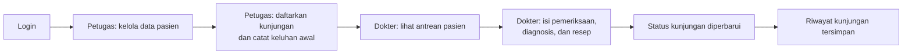

<div align="center">

# 🩺 PulseCare

**Sistem Informasi Manajemen Klinik berbasis Desktop**

Kelola pasien, pendaftaran kunjungan, dan pemeriksaan medis dalam satu aplikasi yang rapi dan terintegrasi.


[Fitur](#-fitur-utama) • [Alur Kerja](#-alur-kerja) • [Tech Stack](#-tech-stack) • [Perancangan](#-perancangan-sistem) • [Struktur](#-struktur-project) • [OOP](#-penerapan-konsep-oop) • [Menjalankan](#-cara-menjalankan) • [Tim](#-anggota-kelompok)

</div>

---

## Tentang PulseCare

PulseCare membantu proses administrasi dan pelayanan pasien di klinik. Petugas mengelola data pasien dan pendaftaran kunjungan, sedangkan dokter melihat antrean dan mencatat hasil pemeriksaan. Setiap peran memiliki hak akses sendiri sehingga pekerjaan berjalan tertib dan terarah.

---

## Fitur Utama

Fitur dibagi berdasarkan peran pengguna agar setiap orang fokus pada tugasnya.

| Peran | Yang Bisa Dilakukan |
|---|---|
| **Admin** | Mengakses dashboard admin<br>Mengelola akun pengguna sesuai hak akses |
| **Petugas** | Melihat ringkasan informasi di dashboard<br>Menambah, mengubah, mencari, dan melihat data pasien<br>Mendaftarkan kunjungan pasien ke poliklinik<br>Mencatat keluhan awal saat pendaftaran<br>Melihat riwayat kunjungan pasien |
| **Dokter** | Melihat dashboard dan antrean pasien<br>Melihat keluhan awal yang dicatat petugas<br>Mengisi hasil pemeriksaan dan diagnosis<br>Mencatat resep obat dan catatan tindak lanjut<br>Memperbarui status kunjungan |

### Cuplikan Fitur

<table>
  <tr>
    <td align="center" width="33%">
      <br>
      <sub><b>Dashboard Admin</b></sub>
    </td>
    <td align="center" width="33%">
      <br>
      <sub><b>Mencatat Daftar Kunjungan</b></sub>
    </td>
    <td align="center" width="33%">
      <br>
      <sub><b>Pemeriksaan Pasien</b></sub>
    </td>
  </tr>
</table>

---

## Alur Kerja



---

## Tech Stack

| Kategori | Teknologi |
|---|---|
| Bahasa pemrograman | Java |
| IDE | Apache NetBeans |
| Tampilan aplikasi | Java Swing |
| Perancang GUI | NetBeans Swing GUI Builder |
| Database | MySQL |
| Pengelolaan database lokal | Laragon |
| Perancangan database | Oracle SQL Developer Data Modeler |
| Version control | Git dan GitHub |
| Build dan dependency | Maven |

**Library tambahan**

| Library | Kegunaan |
|---|---|
| MySQL Connector/J | Menghubungkan aplikasi Java dengan database MySQL melalui JDBC |

---

## Perancangan Sistem

Diagram berikut dibuat sebagai gambaran sebelum aplikasi dikembangkan.

<details>
<summary><b>Flowchart</b>: alur penggunaan dari login sampai pemeriksaan</summary>
<br>


</details>

<details>
<summary><b>Use Case Diagram</b>: hubungan Admin, Petugas, dan Dokter dengan fitur</summary>
<br>


</details>

<details>
<summary><b>Entity Relationship Diagram (ERD)</b>: tabel database dan relasinya</summary>
<br>


</details>

---

## Struktur Project

> Nama folder dan package perlu disesuaikan dengan source code final.

```text
PulseCare/
├── src/
│   ├── controller/
│   ├── dao/
│   ├── database/
│   ├── model/
│   └── view/
├── docs/
│   ├── flowchart.png
│   ├── use-case.png
│   ├── erd.png
│   ├── dashboard-admin.png
│   ├── daftarkan-kunjungan.png
│   └── form-pemeriksaan.png
├── nbproject/
├── pom.xml
└── README.md
```

| Package | Fungsi |
|---|---|
| `controller` | Mengatur proses aplikasi dan menghubungkan tampilan dengan pengolahan data |
| `dao` | Mengambil, menambah, mengubah, dan menghapus data di database |
| `database` | Menyimpan pengaturan dan proses koneksi database |
| `model` | Class yang mewakili data atau objek dalam sistem |
| `view` | Tampilan aplikasi yang dibuat dengan Java Swing |
| `docs` | Diagram perancangan dan screenshot aplikasi |

---

## Penerapan Konsep OOP

PulseCare dibuat dengan konsep Object-Oriented Programming. Empat konsep utamanya:

| Konsep | Penjelasan |
|---|---|
| **Encapsulation** | Membatasi akses langsung ke atribut class. Atribut dibuat `private` dan diakses lewat getter/setter. |
| **Inheritance** | Pewarisan atribut dan method dari class induk ke turunannya. Contoh: `Akun` sebagai induk dari `Admin`, `Dokter`, dan `Petugas` bila rancangan ini diterapkan. |
| **Polymorphism** | Method yang sama berperilaku berbeda tergantung objeknya, misalnya lewat method yang di-override class turunan. |
| **Abstraction** | Menampilkan bagian penting dan menyembunyikan detail proses, melalui `abstract class` atau `interface`. |

**Contoh encapsulation**

```java
public class Pasien {
    private String namaLengkap;

    public String getNamaLengkap() {
        return namaLengkap;
    }

    public void setNamaLengkap(String namaLengkap) {
        this.namaLengkap = namaLengkap;
    }
}
```

> **Penting:** Sesuaikan bagian inheritance, polymorphism, dan abstraction dengan source code final kelompok. Jangan mencantumkan contoh sebagai fitur yang sudah diterapkan jika implementasinya belum ada.

---

## Cara Menjalankan

### Prasyarat

- [x] JDK sesuai kebutuhan project
- [x] Apache NetBeans
- [x] MySQL (bisa dijalankan lewat Laragon)
- [x] Database PulseCare beserta tabel yang dibutuhkan
- [x] Dependency project, termasuk MySQL Connector/J

### Langkah

1. Buka **Laragon**, lalu jalankan **MySQL**.
2. Pastikan database **PulseCare** sudah dibuat dan tabelnya tersedia.
3. Buka project PulseCare melalui **Apache NetBeans**.
4. Periksa konfigurasi koneksi database.
5. Jalankan project dari NetBeans.
6. Login menggunakan akun yang sudah terdaftar.

---

## Tampilan Aplikasi

<details open>
<summary><b>Login dan Dashboard</b></summary>
<br>

| Halaman Login | Dashboard |
|:---:|:---:|
|  |  |

</details>

<details>
<summary><b>Petugas</b>: kelola pasien, pendaftaran kunjungan, riwayat</summary>
<br>

| Kelola Data Pasien | Pendaftaran Kunjungan |
|:---:|:---:|
|  |  |

**Riwayat Kunjungan**


</details>

<details>
<summary><b>Dokter</b>: antrean dan form pemeriksaan</summary>
<br>

| Antrean Dokter | Form Pemeriksaan |
|:---:|:---:|
|  |  |

</details>

---

## Anggota Kelompok

| No. | Nama | NIM |
|:---:|---|---|
| 1 | Nama Anggota 1 | NIM |
| 2 | Nama Anggota 2 | NIM |
| 3 | Nama Anggota 3 | NIM |
| 4 | Nama Anggota 4 | NIM |

---

<div align="center">

<sub>PulseCare dikembangkan sebagai proyek pembelajaran untuk menerapkan pemrograman Java, konsep OOP, pengelolaan database, dan pembuatan antarmuka aplikasi desktop.</sub>

</div>
